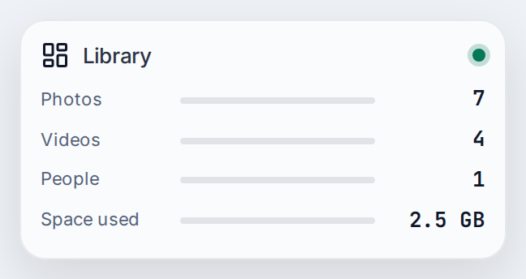
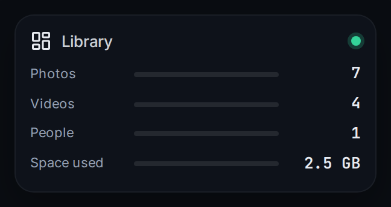

# Library

Shows what is in your Immich library at a glance: the number of photos and videos, how many people use it and how much space it takes. It needs the API key of an administrator.

| | |
|---|---|
| Type | Card |
| Category | Media |
| Version | 1.0.0 |
| Author | [DerKezorm](https://github.com/DerKezorm) |
| Reach | read |

 

Submitted under the [MIT License](../../../LICENSE).
