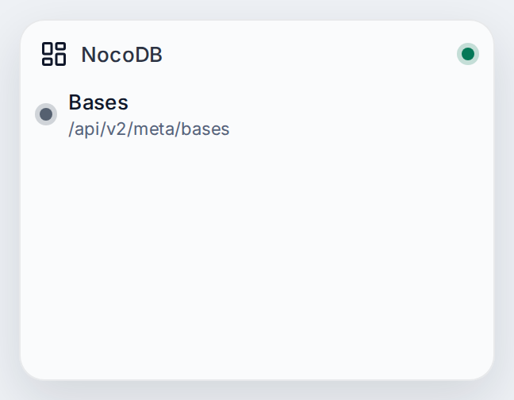
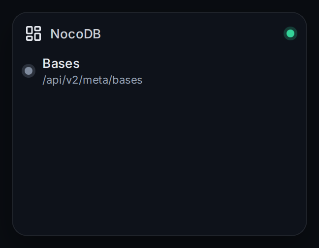

# NocoDB

Connects nexdeck to NocoDB, the spreadsheet-like front end for databases. It uses an API token that is sent in the header xc-token, so there is no sign-in to keep. Your cards can then read the bases and, with a path, the rows of a table.

| | |
|---|---|
| Type | Connection |
| Category | Other |
| Version | - |
| Author | [DerKezorm](https://github.com/DerKezorm) |
| Reach | read |

 

Submitted under the [MIT License](../../../LICENSE).
