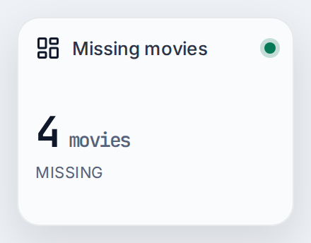
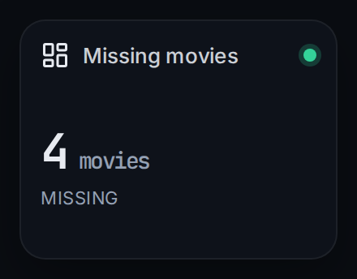

# Missing movies

Shows how many of the movies in your Radarr library are monitored but still missing. The card turns yellow as soon as at least one movie is missing.

| | |
|---|---|
| Type | Card |
| Category | Media |
| Version | 1.0.0 |
| Author | [DerKezorm](https://github.com/DerKezorm) |
| Reach | read |

 

Submitted under the [MIT License](../../../LICENSE).
