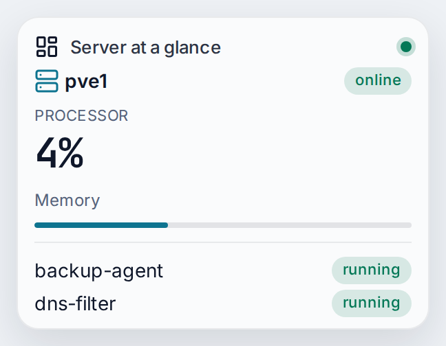
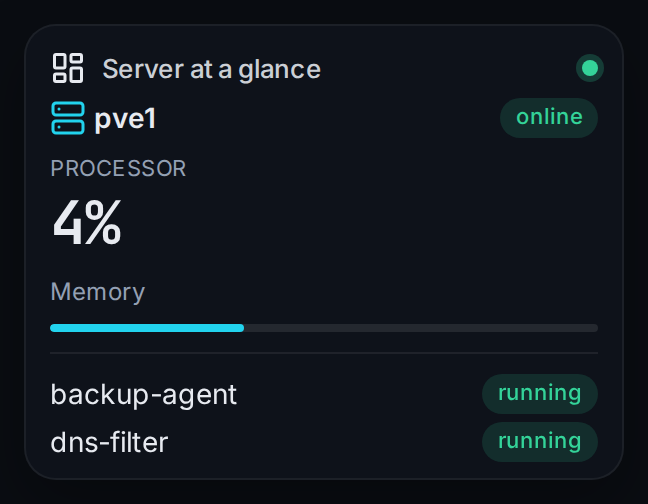

# Server at a glance

Shows the first node of your Proxmox host with its processor and memory load, and the guests of the cluster with their state. The card only reads and changes nothing. It was checked against a live Proxmox VE 9 host.

| | |
|---|---|
| Type | Card |
| Category | Server |
| Version | 1.0.0 |
| Author | [DerKezorm](https://github.com/DerKezorm) |
| Reach | read |

 

Submitted under the [MIT License](../../../LICENSE).
