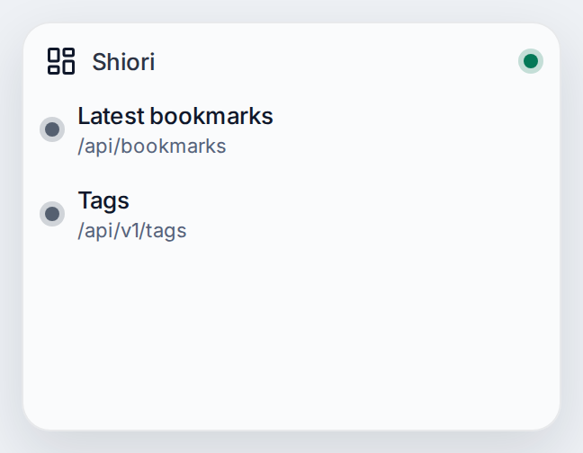
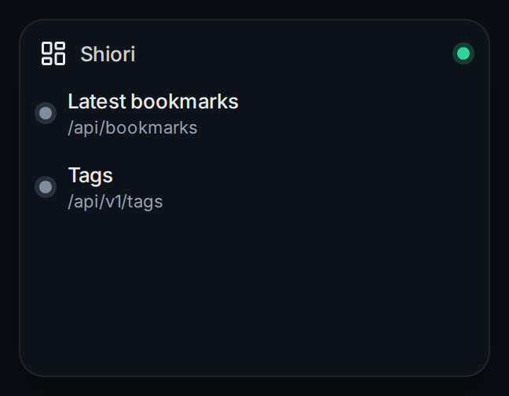

# Shiori

Connects nexdeck to Shiori, a simple bookmarks manager you host yourself. It signs in with your account and keeps the session. Your cards can then read the latest bookmarks and the tags.

| | |
|---|---|
| Type | Connection |
| Category | Other |
| Version | - |
| Author | [DerKezorm](https://github.com/DerKezorm) |
| Reach | login |

 

Submitted under the [MIT License](../../../LICENSE).
