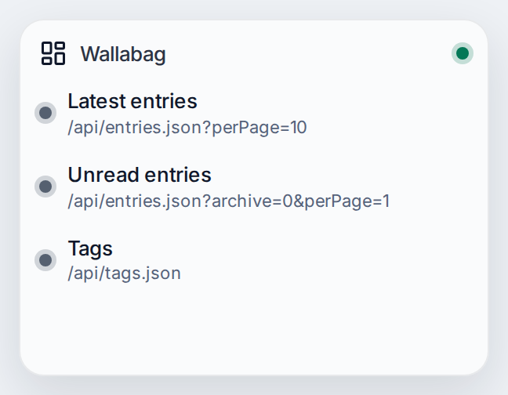
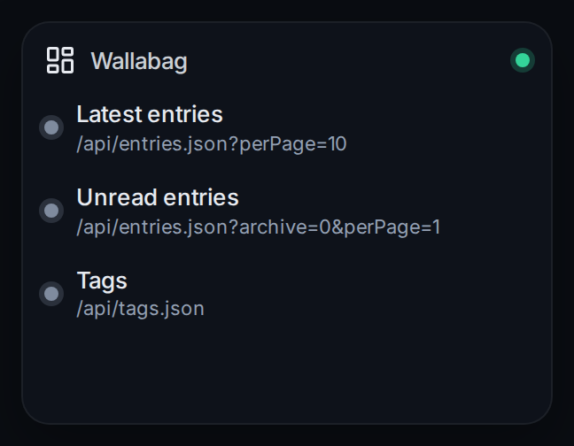

# Wallabag

Connects nexdeck to Wallabag, the read-it-later service you host yourself. It signs in with the API client and the account of the Wallabag user, the way the apps of Wallabag do, and keeps the session. Your cards can then read the entries and the tags.

| | |
|---|---|
| Type | Connection |
| Category | Other |
| Version | - |
| Author | [DerKezorm](https://github.com/DerKezorm) |
| Reach | login |

 

Submitted under the [MIT License](../../../LICENSE).
